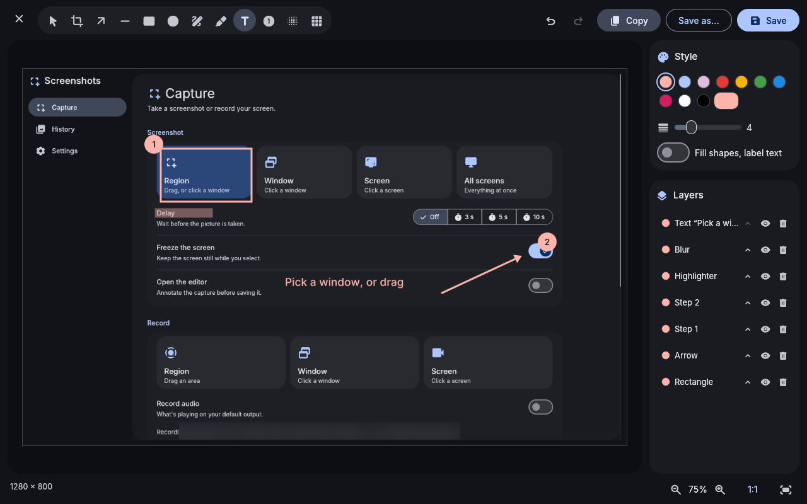
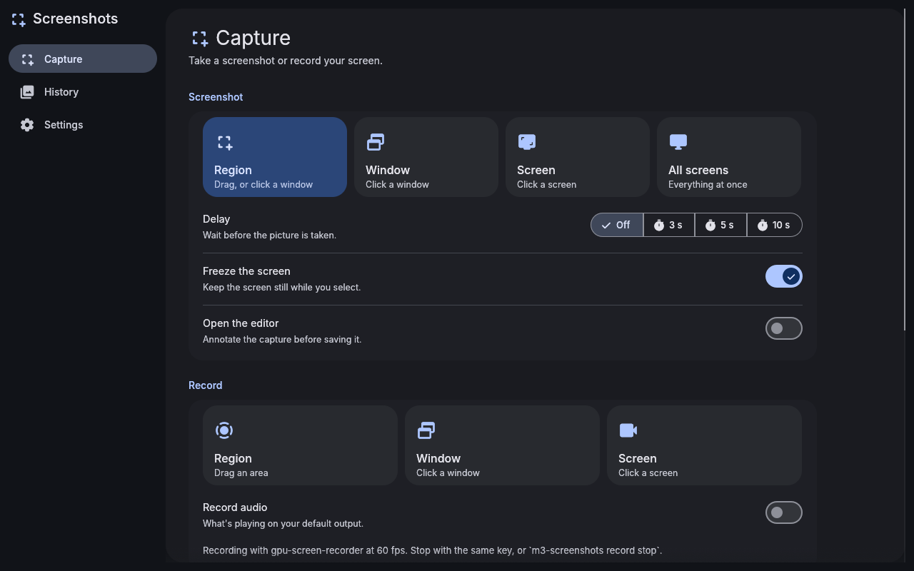
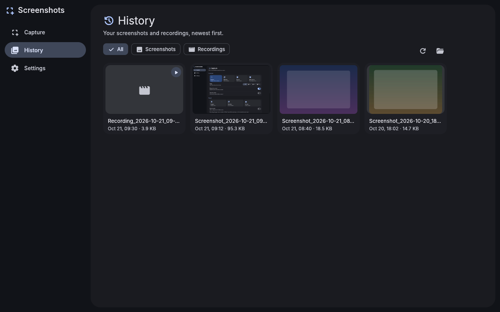
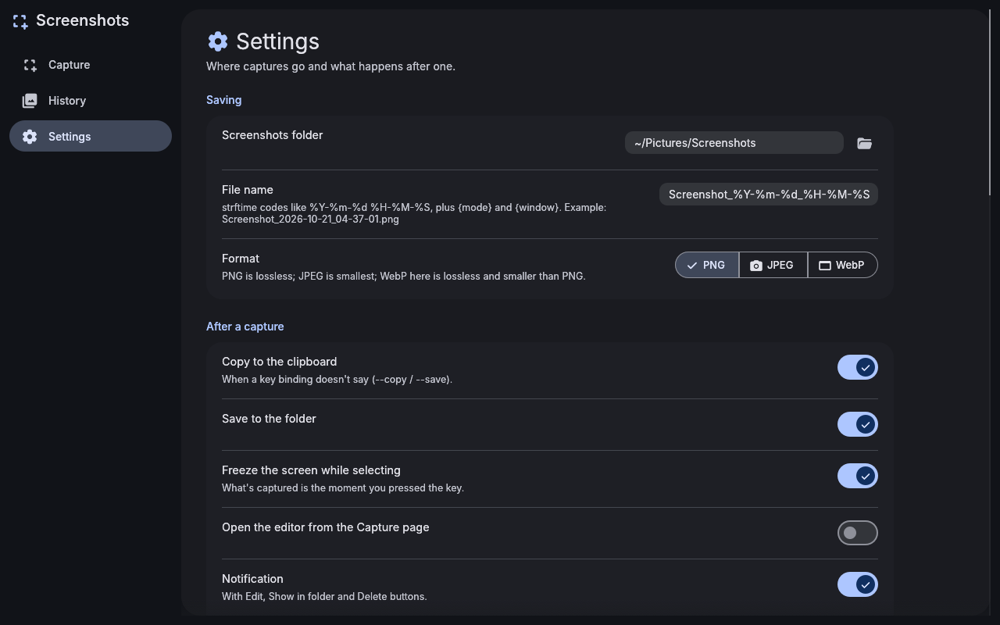

# Material 3 Screenshots

Screenshots, an annotation editor and a screen recorder for Hyprland, built with [egui](https://github.com/emilk/egui) and themed with Material You. It shares its look with the other Material 3 apps through [material-3-ui](https://github.com/bhimio1/material-3-ui), and on an end-4 desktop it takes its colors from your wallpaper, like the shell does. Even the selection overlay uses them.

It's one of the essential apps of the [end4-pC fork](https://github.com/bhimio1/end4-pC). The shell installs it and binds your screenshot keys to it, so the command line is built to start fast and never needs the window.






## Features

**Capture**
- **Modes:** region, window, output (screen) or all outputs.
  - In region mode you can drag a rectangle or click a window.
  - `--active` takes the focused window or screen without asking.
- **Freeze:** the screen is grabbed the moment you press the key and shown still while you select. Menus, tooltips and video don't change under you. The picture is cropped from that grab, so it's exactly what was on screen.
- **HiDPI and mixed scales:** captures come out at full resolution. A whole screen comes out at its own native pixels, even next to a screen with a different scale.
- **Delay:** wait a few seconds first.
- **After a capture:** copy to the clipboard, save under your file name pattern, or both, in PNG, JPEG or WebP.
- **Notification:** shows the picture, with **Edit**, **Show in folder** and **Delete** buttons. Captures that were only copied get **Save** instead.
- **Shutter sound** (optional).

**Editor**
- **Tools:**
  - crop;
  - arrows and lines;
  - rectangles and ellipses, outlined or filled;
  - pen and highlighter;
  - text, plain or on a label;
  - numbered steps;
  - blur and pixelate.
- **Layers:** the capture stays untouched underneath. Every annotation stays editable until you save: select, move, restyle, hide, reorder or delete it.
- **Colors:** your theme's colors, a few fixed ones, or any custom color. One size setting controls stroke width, text size and blur strength.
- **Undo and redo,** zoom to the pointer, pan, fit, 1:1.
- **Export:** Copy, Save (next to the original as `name-edited`), or Save as PNG, JPEG or WebP anywhere.
- **What you see is what's saved:** the preview and the export use the same renderer.
- **Keys:**
  - tools: V, C, A, L, R, E, P, H, T, N, B, X;
  - Ctrl+Z, Ctrl+Shift+Z: undo, redo;
  - Ctrl+C: copy;
  - Ctrl+S, Ctrl+Shift+S: save, save as;
  - Delete removes the selected layer;
  - 0 fits, 1 shows actual size;
  - Shift snaps lines to 45° and makes squares.

**Recording**
- **Recorder:** [gpu-screen-recorder](https://git.dec05eba.com/gpu-screen-recorder/about/) (hardware encoding) when installed, else wf-recorder.
- **Settings:** frame rate, quality and the cursor.
- **Audio:** whatever is playing (your default output's PipeWire monitor).
- **Stopping:** press the same key again (`--toggle`) or run `m3-screenshots record stop`. The file is finished properly, then a notification offers **Play**, **Show in folder** and **Delete**.
- **Shell indicator:** while recording, `$XDG_RUNTIME_DIR/m3-screenshots/recording.json` exists, and `m3-screenshots status --json` reports it. end4-pC's own recording indicator (`record.enable` in the shell's `states.json`) is kept in step.

**History:** every screenshot and recording, newest first, with thumbnails (`ffmpegthumbnailer` adds them for videos).
- Edit, copy, open, show in folder or delete.
- Captures that were only copied are kept for a while, so they can still be saved.

**Settings:**
- folders;
- file name pattern (strftime codes plus `{mode}` and `{window}`);
- format and JPEG quality;
- what a capture does by default;
- freeze, notification and shutter sound;
- the recorder;
- the shared Appearance card;
- a Tools list that installs anything missing.

## Command line

```
m3-screenshots                          open the app
m3-screenshots region|window|output|all [--edit] [--copy] [--save] [--delay N]
                                        [--freeze|--no-freeze] [--active] [--no-notify]
m3-screenshots record region|window|output [--audio|--no-audio] [--toggle] [--active]
m3-screenshots record stop
m3-screenshots status [--json]
m3-screenshots edit FILE
m3-screenshots import FILE|- [--edit] [--copy] [--save] [--no-notify]
m3-screenshots history | settings
```

- **Import:** `import` takes an image another tool captured (a file, or PNG on stdin with `-`) and finishes it like a capture: clipboard, save, notification and history. end4-pC's region selector hands its captures over this way.

- **Defaults:** with neither `--copy` nor `--save`, the settings decide (both, by default). `--edit` on its own opens the editor and leaves saving to you.
- **Output:** a saved file's path is printed on stdout.
- **Exit codes:** 0 on success; 1 for a failure or a selection cancelled with Escape (no notification then); 2 for a usage error.
- **Status:** `status --json` prints `{"recording":false}` or `{"recording":true,"file":…,"mode":…,"backend":…,"audio":…,"started":…,"elapsed":…,"pid":…}`.

Suggested Hyprland bindings, for `~/.config/hypr/custom/keybinds.lua` on end-4 setups (the shell's own `Super+Shift+S` region snip already hands its captures to this app):

```lua
hl.bind("Print", hl.dsp.exec_cmd("m3-screenshots output --active"))
hl.bind("SUPER + SHIFT + S", hl.dsp.exec_cmd("m3-screenshots region"))
hl.bind("SUPER + SHIFT + E", hl.dsp.exec_cmd("m3-screenshots region --edit"))
hl.bind("SUPER + SHIFT + W", hl.dsp.exec_cmd("m3-screenshots window --active"))
hl.bind("SUPER + SHIFT + R", hl.dsp.exec_cmd("m3-screenshots record region --toggle"))
hl.bind("SUPER + SHIFT + ALT + R", hl.dsp.exec_cmd("m3-screenshots record output --active --audio --toggle"))
```

## Install

From the AUR, prebuilt or built from source:

```sh
paru -S material-3-screenshots-bin   # or material-3-screenshots-git
```

From this repository, with the included PKGBUILD:

```sh
cd packaging
makepkg -si
```

Prebuilt x86_64 binaries are attached to [releases](https://github.com/bhimio1/material-3-screenshots/releases). The end4-pC fork installs the latest one automatically.

It needs `grim`, `slurp` and `wl-clipboard`. These are optional:
- `hyprpicker` shows the frozen screen;
- `gpu-screen-recorder` or `wf-recorder` records;
- `sound-theme-freedesktop` plays the shutter sound;
- `ffmpegthumbnailer` adds video thumbnails.

Or build directly:

```sh
cargo build --release
./target/release/m3-screenshots region
```

## Theme

In Settings, **Auto** uses the end-4 shell's generated colors (`~/.local/state/quickshell/user/generated/colors.json`). If those don't exist it uses the file manager's matugen `theme.json`, and otherwise a seed color. The window follows wallpaper changes live. slurp's selection colors come from the same palette.

Settings are stored in `~/.config/m3-screenshots/config.toml`.

## Project layout

```
src/
  main.rs       command dispatch
  cli.rs        argument parsing
  capture.rs    selection (slurp, hyprctl), freezing, grim
  geometry.rs   logical rectangles, HiDPI crop maths
  hypr.rs       hyprctl monitors / clients / activewindow
  deliver.rs    encode, save, clipboard, shutter, the notification and its buttons
  record.rs     recorder command lines, supervisor, state file, status
  notify.rs     notification defaults (material-3-ui does the D-Bus)
  naming.rs     file name patterns
  history.rs    what History lists
  annotate.rs   editor document and renderer (tiny-skia, ab_glyph)
  ui/           window: capture, history, settings, editor
tests/e2e/      command-line tests against stub tools
```

## Tests

`cargo test` covers:
- argument parsing;
- `hyprctl` JSON;
- layout and HiDPI maths;
- file name patterns;
- recorder command lines;
- encoding;
- the renderer;
- editor behaviour.

`tests/e2e/run.sh` drives the real binary against stub `grim`, `slurp`, `wl-copy`, `hyprctl`, `hyprpicker` and recorders, with a fake notification server on a private D-Bus. It needs Python with dbus-python and PyGObject, and ImageMagick. The stub grim encodes every pixel's layout position, so frozen crops and scaling are checked to the pixel.

## License

MIT, see [LICENSE](LICENSE).

Fonts: Inter (SIL OFL 1.1, see `assets/fonts/LICENSE-Inter.txt`). Icons: Material Symbols, via `egui_material_icons`.
